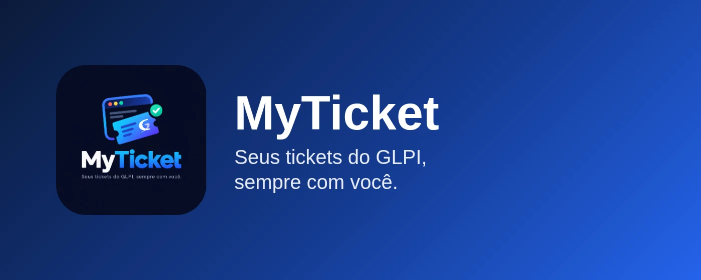
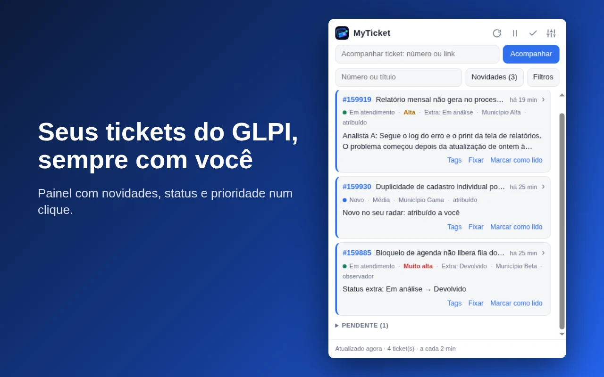
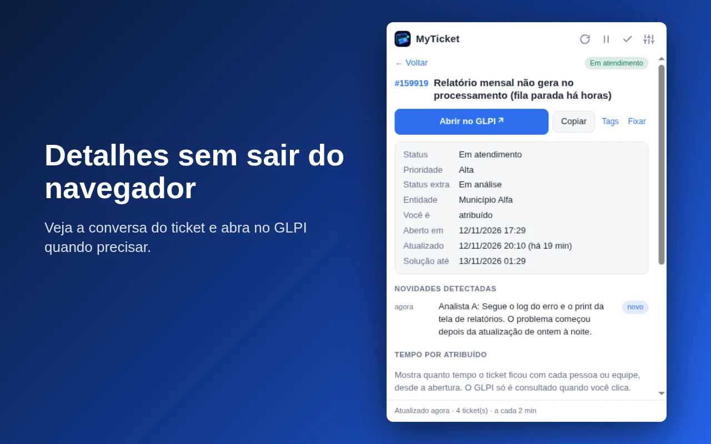
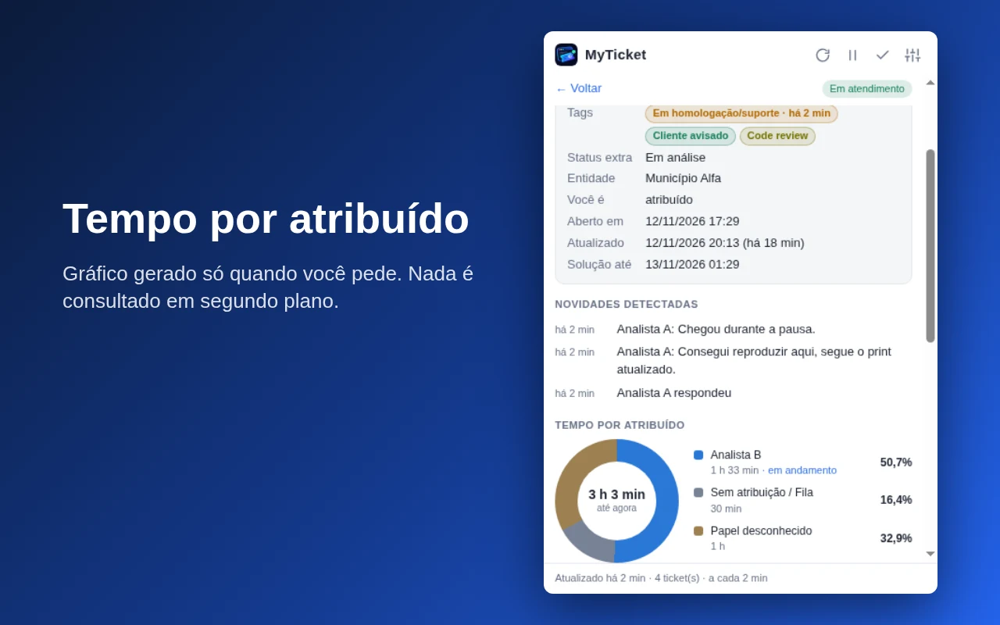
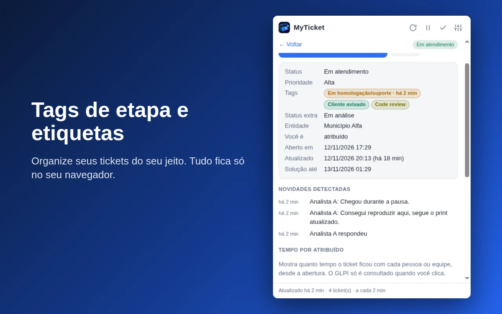

<div align="center">



<br>

**Notificações e painel dos seus tickets do GLPI, direto no navegador. Sem depender de e-mail.**

<br>

[](https://chromewebstore.google.com/detail/myticket/phbofombfpjafeneiikpjhnhnjedbced)
[](https://chromewebstore.google.com/detail/myticket/phbofombfpjafeneiikpjhnhnjedbced)
[](https://github.com/Sysvale/my-ticket/actions/workflows/tests.yml)
[](https://github.com/Sysvale/my-ticket/actions/workflows/seguranca.yml)
[](LICENSE)


[**Instalar**](#-instalação) · [**Como começar**](#-como-começar) · [**Segurança**](#-segurança-e-privacidade) · [**Documentação**](DOCUMENTACAO.md) · [**Contribuir**](#-contribuindo)

</div>

<br>

<p align="center"></p>

## ✨ Por que o MyTicket?

Quem atende chamados no GLPI vive entre duas dores: o e-mail que chega tarde (ou não chega) e a aba do GLPI aberta o dia
inteiro só para ver se alguém respondeu. O MyTicket resolve isso: ele **olha o GLPI por você** e **avisa na hora**, com a
notificação do próprio sistema, quando alguém responde, propõe uma solução ou muda o status de um ticket seu.

## 🚀 Destaques

| | |
|---|---|
| 🔔 **Notificações de verdade** | Resposta nova, solução proposta, mudança de status e ticket novo no seu radar, com botões **Abrir** e **Marcar como lido**, e aviso sonoro opcional. |
| 🧭 **Descobre os seus tickets** | Acha sozinho os tickets em aberto em que você é atribuído, observador ou requerente. Acompanhe qualquer outro pelo número ou link. |
| 🔎 **Popup com busca e filtros** | Busca sem diferenciar acentos, filtros por status, papel, entidade, prioridade e tag (com seleção múltipla) e agrupamento por status, prioridade ou etapa. |
| 📌 **Fixados e parados** | Fixe tickets no topo, mesmo com filtros ligados, e veja de relance os que estão **parados** (borda âmbar e vermelha). |
| 🏷️ **Tags suas** | Etiquetas e etapas pessoais nos tickets. Ficam só no seu navegador: nunca vão para o GLPI. |
| ⏱️ **Tempo por atribuído** | Um gráfico de rosca mostra quanto tempo o ticket ficou com cada pessoa ou equipe, **gerado só quando você pede**. |
| ⌨️ **Barra de endereços** | Digite `ticket 148270` e Enter: o ticket abre no GLPI (ou só ganha o foco, se já estiver aberto). |
| 🎨 **Temas** | Claro, escuro e efeito neon opcional. |

## 📦 Instalação

| Navegador | Como instalar |
|---|---|
| **Google Chrome** | [Chrome Web Store](https://chromewebstore.google.com/detail/myticket/phbofombfpjafeneiikpjhnhnjedbced) |
| **Brave, Edge, Opera, Vivaldi** | Também pela [Chrome Web Store](https://chromewebstore.google.com/detail/myticket/phbofombfpjafeneiikpjhnhnjedbced): esses navegadores instalam extensões dela normalmente. |
| **Firefox** | Em breve no addons.mozilla.org. Por enquanto, veja [a documentação](DOCUMENTACAO.md#instalar-uso-pessoal-sem-web-store). |
| **A partir do código** | `git clone` e carregue a pasta `extension/` em `chrome://extensions` (modo desenvolvedor → *Carregar sem compactação*). |

> 💡 Dica: abra o link da loja **sem** parâmetros (`?hl=…`). Assim o Brave mostra "Usar no Brave" no botão.

## 🏁 Como começar

1. **Instale** a extensão e clique no ícone: o popup pede para configurar a conexão.
2. No **GLPI**, gere os dois tokens: em *Preferências* → **Chave de acesso remoto**, copie o **token de API pessoal**
   (`user_token`); o **App-Token** vem de *Configurar → Geral → API* (cliente da API), ou de quem administra o seu GLPI.
3. Nas **Opções → Conexão**, informe a URL do GLPI (`https://glpi.suaempresa.com`), os tokens e clique em **Testar
   conexão**. O navegador pede permissão **só para o site do seu GLPI**.
4. **Salvar**. Pronto: a primeira verificação lista os seus tickets sem avisar o histórico, e a partir daí você só recebe
   o que for novo.

> Requer um GLPI com a **API REST legada** habilitada (`/apirest.php`). A senha do GLPI nunca passa pela extensão.

## 🖼️ Capturas

<table>
  <tr>
    <td width="50%"><br><sub><b>Detalhes sem sair do navegador:</b> a conversa do ticket, e um clique para abrir no GLPI.</sub></td>
    <td width="50%"><br><sub><b>Tempo por atribuído:</b> gráfico gerado só quando você pede.</sub></td>
  </tr>
  <tr>
    <td width="50%"><br><sub><b>Tags de etapa e etiquetas:</b> organize do seu jeito; tudo fica só no seu navegador.</sub></td>
    <td width="50%"><br><sub><b>Novidades em destaque:</b> o que mudou desde a última vez que você olhou.</sub></td>
  </tr>
</table>

<sub>Todos os dados das capturas são fictícios.</sub>

## 🔒 Segurança e privacidade

O MyTicket guarda o endereço do seu GLPI e os seus tokens, então a segurança é parte do produto, e não um detalhe:

- **Somente leitura.** A extensão só faz requisições `GET`: nunca cria nem altera nada no GLPI.
- **Só `https://`.** `http://` é recusado em três camadas (Opções, cliente da API e manifest).
- **Um único destino.** Os tokens só vão ao GLPI que **você** configurou, em cabeçalhos (nunca na URL), e o cliente
  **não segue redirecionamentos**.
- **Sem telemetria.** Sem servidor próprio, sem analytics, sem anúncios, sem código remoto, sem dependências de terceiros.
- **Tudo no seu navegador.** Nada sincroniza com a conta Google. **Ocultar conteúdo** esconde título e texto nas
  notificações, e um botão **apaga todos os dados locais** de uma vez.
- **As garantias são testadas, não só prometidas:** testes automáticos quebram se alguém introduzir `innerHTML`, `eval`,
  `console.*`, rede fora do cliente do GLPI, `storage.sync` ou um CSP mais frouxo, e um teste de ponta a ponta confirma que
  **nenhum token vaza** (storage, notificações, ícone, páginas, logs e URLs).

Os tokens ficam em `chrome.storage.local`, **sem criptografia em disco** (como um arquivo `.env`). Use um token de um perfil
com o menor privilégio possível. Leia o [modelo de ameaça e os limites conhecidos](SECURITY.md) e a
[política de privacidade](PRIVACY.md).

## 📚 Documentação

Tudo o que não cabe aqui está na **[documentação completa](DOCUMENTACAO.md)**: todas as opções, onde ficam os tokens, como
as tags funcionam, a estrutura do código, o CI e o teste visual ponta a ponta.

## 🧑‍💻 Contribuindo

```bash
git clone https://github.com/Sysvale/my-ticket.git && cd my-ticket
npm test                 # testes unitários e de invariantes (Node 20+, sem dependências)
npm run lint:install && npm run lint   # ESLint (isolado em tools/lint/)
npm run e2e              # teste ponta a ponta no Chromium, com um GLPI simulado
npm run build:chrome     # zip para a Chrome Web Store e o Edge
npm run build:firefox:zip   # zip para o addons.mozilla.org
```

O projeto **não tem dependências de produção**: o que vai para o navegador é exatamente o conteúdo de `extension/`. Para
**reportar uma vulnerabilidade**, veja o [SECURITY.md](SECURITY.md) (por favor, sem issue pública).

## 💙 Créditos

A ideia do MyTicket e o desenvolvimento da extensão são de **[Igor Vinícius](https://github.com/IhGori)**. Este projeto
existe por causa dessa ideia. 🙌

Mantido pela **[Sysvale](https://sysvale.com)**.

## 📄 Licença

[GNU Affero General Public License v3.0](LICENSE). O MyTicket é software livre: você pode usar, estudar, modificar e
redistribuir, mantendo a mesma licença (inclusive para quem o usa por uma rede).

<div align="center"><sub>Feito com ☕ para quem vive de chamados.</sub></div>
